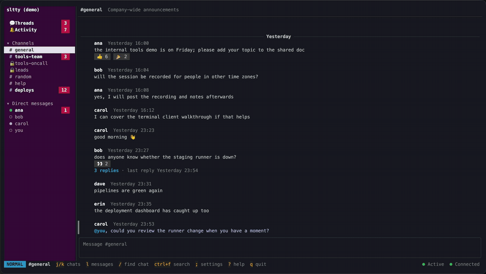

# sltty

[](https://github.com/oscarmlage/sltty/actions/workflows/ci.yml)
[](https://github.com/oscarmlage/sltty/actions/workflows/ci.yml)
[](LICENSE)

Keyboard-first Slack client for the terminal: the chat list and the open chat
side by side, with a draggable divider and vim-like modes.



**Status: early and experimental.** It starts in demo mode (made-up data, no
network). `sltty login` enables an optional, *unofficial* Slack connection
that uses your browser session; read the
[security model](docs/slack-session.md) before using it.

**Disclaimer:** sltty is unofficial and is not affiliated with, endorsed by,
or sponsored by Slack Technologies, LLC. “Slack” is a trademark of Slack
Technologies, LLC.

## Install

Requires Go (the version in [`go.mod`](go.mod)).

```sh
go install github.com/oscarmlage/sltty/cmd/sltty@latest
# or from a checkout:
make build          # bin/sltty
make install        # to ~/.local/bin (PREFIX=... to change)
```

Platforms: macOS and Linux; Windows builds but is untested. `login --desktop`
is macOS only; `login --browser` needs Chrome, Chromium, Brave or Edge.

Terminals: any with truecolor. Pictures use the kitty graphics protocol
(kitty, Ghostty, WezTerm) or half blocks elsewhere; copy-on-select needs OSC 52;
`shift+enter` needs the kitty keyboard protocol (otherwise `alt+enter` or
`ctrl+j`).

## Quick start

```sh
make run ARGS=-demo     # build and open it with the built-in demo data
sltty login             # optional: connect to Slack (see docs/slack-session.md)
sltty                   # demo without a saved session, Slack with one
```

`?` lists every key, `:` is a command line, `;` is the settings panel.

## Command line

```text
sltty [-config file] [-demo]
sltty keys                          print every key binding as a config file
sltty config                        list what the config file takes
sltty login [--browser|--desktop]   sign in through Chrome or Slack Desktop
sltty logout                        remove the saved Slack session
```

`-config` selects the JSON config file; `-demo` ignores any saved Slack session.

## Look

Two layouts, any theme in either:

- `slack`: filled aubergine sidebar, composers in rounded boxes (ideas from
  msga, make-slack-great-again);
- `panels`: every pane boxed, `▌` cursor and `•` unread dots, filled
  composers (ideas from slk).

Built-in themes: aubergine (slack layout), terminal, dracula, nord, slk, tokyo
night, gruvbox, catppuccin, solarized, light. `T` picks one with a live
preview, `L` switches layout.

## More demos

Short recordings of each feature (switcher and search, threads, reactions,
themes, sidebar sections, pictures, command line) are in
[`docs/assets/demo/`](docs/assets/demo/).

## Documentation

- [Keys and mouse](docs/keys.md)
- [Configuration and features](docs/config.md): config file, command line,
  sidebar sections, messages, images and custom emoji
- [Slack session and security model](docs/slack-session.md)
- [Architecture](docs/architecture.md)
- [Contributing](CONTRIBUTING.md) and [security policy](SECURITY.md)

## Development

```sh
make check     # gofmt, vet, tests (what CI runs)
make cover     # total coverage (make cover-html for the report)
make demo      # re-record docs/assets/demo/*.gif (macOS, kitty, ffmpeg; uses -demo only)
```

## Credits

Inspired by [slk](https://github.com/gammons/slk) and make-slack-great-again
in look and feel; no code is taken from either, and the Slack connection is
our own. Emoji names are generated from
[iamcal/emoji-data](https://github.com/iamcal/emoji-data) (see
[NOTICE.md](NOTICE.md)).

## License

[MIT](LICENSE)
