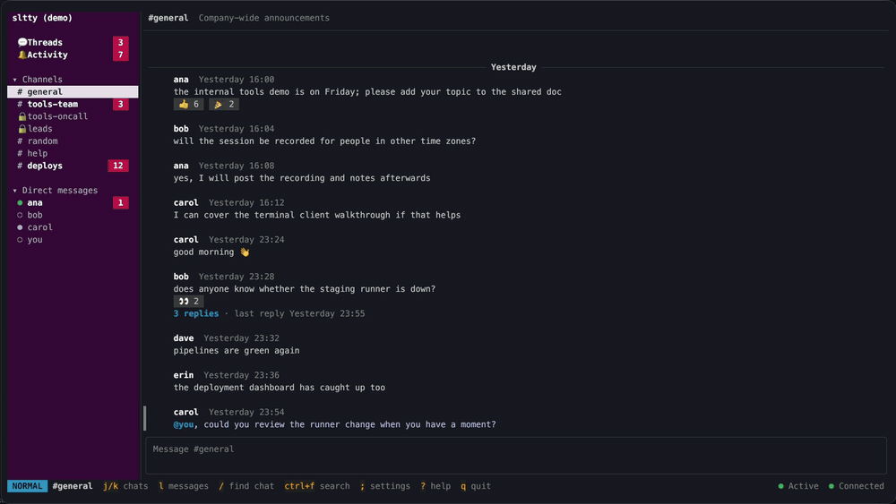
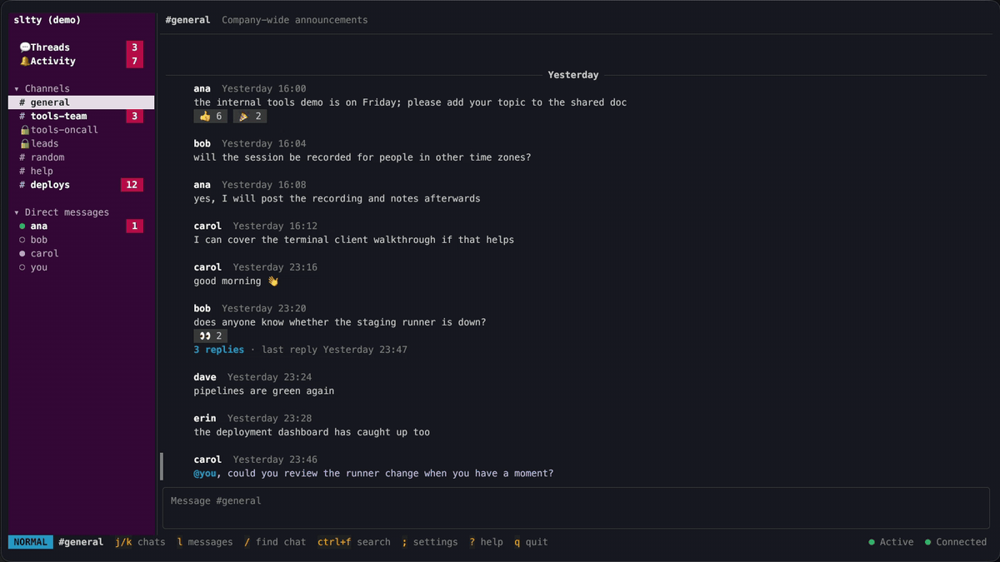
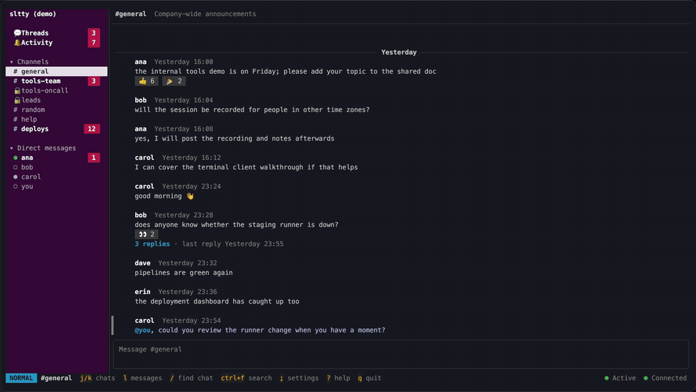
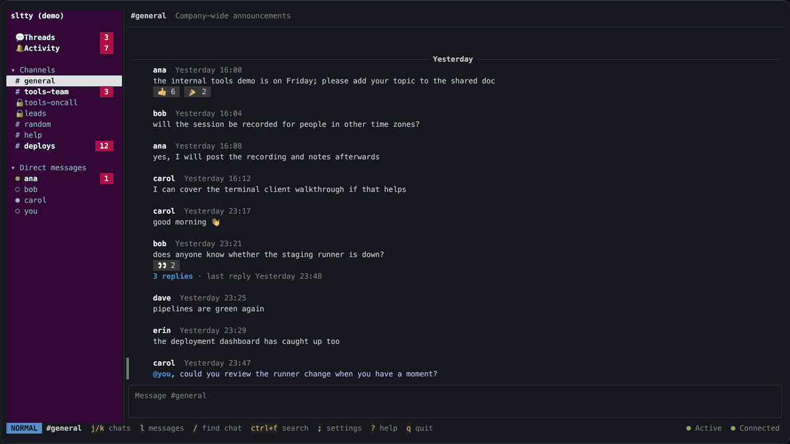
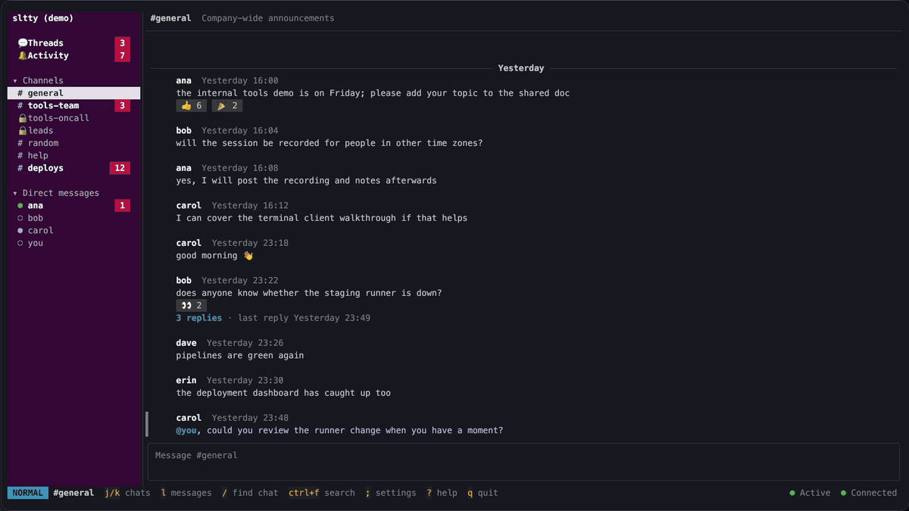

# Demos

Recorded against the built-in demo data (`make demo`, see [`scripts/record-demo.py`](../../../scripts/record-demo.py)); the `.tape` next to each GIF is its script.

## hero

Everything in one take. [`hero.tape`](hero.tape)

## switcher

Quick switcher (`ctrl+k`) and message search (`ctrl+f`). [`switcher.tape`](switcher.tape)

## threads

Open a thread, reply, mark unread. [`threads.tape`](threads.tape)

## reactions

Who reacted, and reacting. [`reactions.tape`](reactions.tape)

## themes

Themes with live preview, and the two layouts. [`themes.tape`](themes.tape)

## sections

Folding sidebar sections. [`sections.tape`](sections.tape)

## images

Pictures, avatars, custom emoji and the full-screen viewer. [`images.tape`](images.tape)

## commands

The `:` command line and the settings panel. [`commands.tape`](commands.tape)

